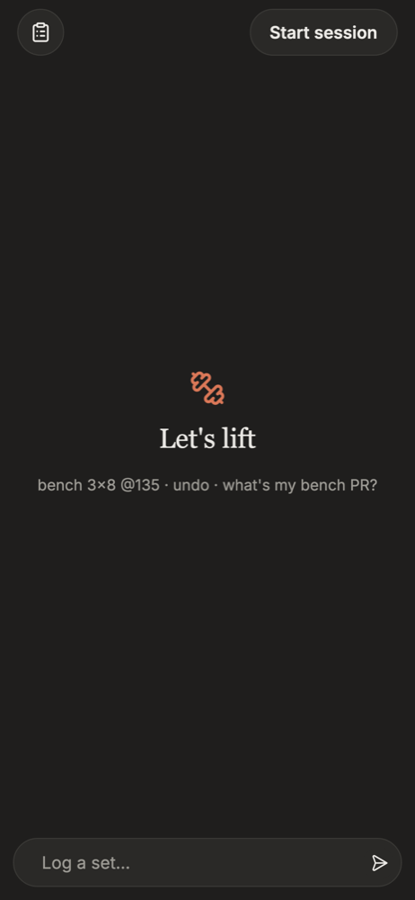
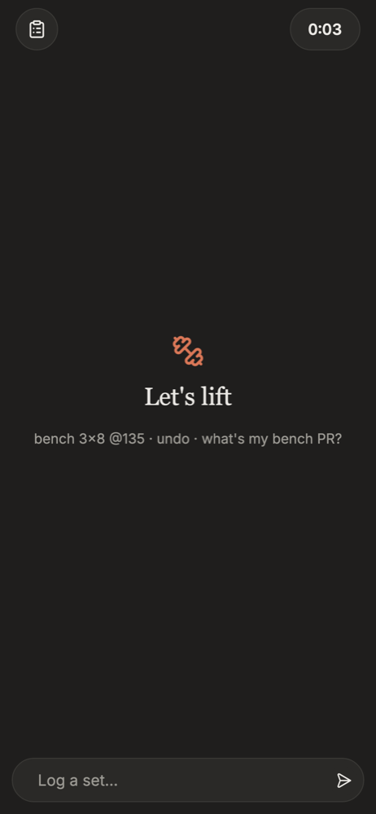
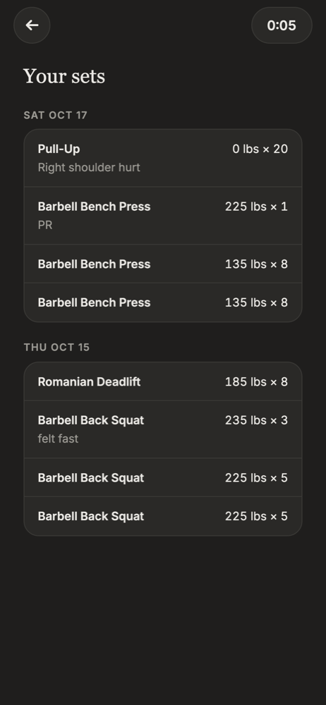
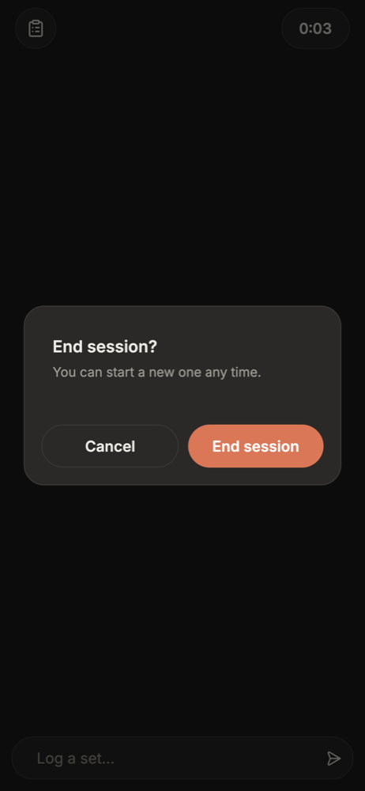
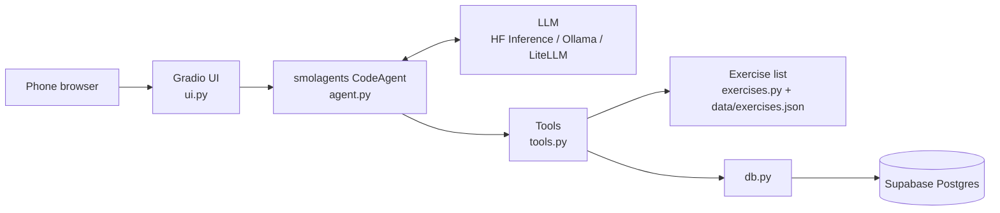

# Gym Agent

A gym logger you text like a training partner. Type `bench 3x8 @135` between sets and an LLM agent turns it into database writes; ask "what did I do last week?" and it answers from your history. It's self-hosted: you deploy your own copy, with your own database and your own model key.

<p>
  
  
  
  
</p>

<sub>Screenshots use sample data.</sub>

## What you can type

| Message | What happens |
| --- | --- |
| `bench 3x8 @135` | Logs three sets of 8 at 135 lbs (starts a session if none is open) |
| `incline db 60s for 10, 10, 8` | Logs three sets with different reps |
| `deadlift 1x5 @100kg` | Logs in kg; lbs is the default |
| `another set` | Repeats the last set |
| `my shoulder hurt on that one` | Adds a note to the last set instead of logging a new one |
| `the second bench set was 6 reps` | Edits that set |
| `undo` | Deletes the last set |
| `what's my bench PR?` | Heaviest set for any reps, comparing lbs and kg |
| `when did I last do chest?` | Finds the most recent day with any chest exercise |
| `what did I do last session?` | Recap of your most recent workout: when, how long, every exercise's sets |
| `what did I do last week?` | Day-by-day summary of the last 7 days, rest days included |
| `done` | Ends the session |

The header has a button for a day-grouped list of your sets and a session timer you can start and end by tapping.

## How it works



The model decides what to do; the code decides whether it's allowed. Each step, the agent writes a short Python snippet that calls the tools, for example a loop of three `log_set` calls for `3x8`. Every tool validates its input (known exercise id, `weight >= 0`, `1 <= reps < 200`, `lbs` or `kg`) and returns an `ERROR:` string instead of writing bad data, so the agent can recover or ask. Only `db.py` talks to the database.

The tools:

| Tool | Purpose |
| --- | --- |
| `resolve_exercise` | Fuzzy-matches what you typed (`bp`, `incline db`) to an exercise id |
| `add_exercise` | Adds a custom exercise, only after you confirm |
| `start_session` / `end_session` | Opens and closes a workout session |
| `log_set` | Logs one set |
| `edit_set` / `undo_last_set` | Fixes or removes sets in the current session |
| `get_active_session` | The current session's numbered sets |
| `find_workouts` | One filterable history query: muscle groups, exercises, date range, "the last N days" |
| `get_latest_session` | Overview of the last session: time, duration, volume, every exercise's sets |
| `get_pr` | Personal record for an exercise |

The chat shows each agent step as a collapsible message: its reasoning, the code it ran, and what that printed.

### Design notes

- **`CodeAgent` over tool calling.** The first version used smolagents' `ToolCallingAgent`. Models often replied in plain text instead of a tool call, which the framework treats as an error, so the agent looped and sometimes dropped sets. With `CodeAgent`, every step is a thought plus code, and repeated sets become one loop instead of several calls.
- **One flexible read tool instead of many narrow ones.** `find_workouts` replaced separate "last performance" and "sessions by day" tools. Muscle groups come from the exercise list, so "when did I last do chest?" needed no schema change.
- **The model gets today's date.** Each message carries a "Today is …" line in your timezone, so "last week" resolves to real dates.
- **Single user per deployment.** Every row has a `user_id`, but each deployment serves one person, so there is no sign-up flow. Self-hosting means nobody pays for anyone else's model calls.

## Deploy your own

You need a [Supabase](https://supabase.com) project (the free tier works) and a [Hugging Face](https://huggingface.co) account with a token for model calls.

1. **Create the database.** Make a Supabase project, then apply the schema. The quickest way needs no install: open your project's **SQL Editor**, paste in [`supabase/migrations/20261017000000_init.sql`](supabase/migrations/20261017000000_init.sql), and run it. Or, with the [Supabase CLI](https://supabase.com/docs/guides/cli):

   ```bash
   supabase link --project-ref <your-project-ref>
   supabase db push
   ```

   This creates `sessions`, `sets`, and `user_exercises` with row-level security on and no public policies, so the public anon key can read nothing.

2. **Copy the Space.** [**Duplicate the template Space**](https://huggingface.co/spaces/koyohashi/gym-agent?duplicate=true) into your account. It holds no secrets, so nothing of anyone else's comes with it, and your copy bills only you.
   - **Public** (default): reachable from any browser; your app password protects it.
   - **Private**: hidden from anyone not logged in to Hugging Face as you, behind your app password as well. Stay logged in to huggingface.co on your phone to open it.

3. **Set its secrets and variables** (Space → Settings → Variables and secrets):

   | Name | Type | Value |
   | --- | --- | --- |
   | `SUPABASE_URL` | variable | `https://<your-project-ref>.supabase.co` |
   | `SUPABASE_SERVICE_KEY` | **secret** | Supabase → Project Settings → API → `service_role` key |
   | `MODEL_BACKEND` | variable | `hf` (copied from the template) |
   | `MODEL_ID` | variable | e.g. `deepseek-ai/DeepSeek-V4-Flash-0731` (copied from the template) |
   | `HF_TOKEN` | **secret** | A token with "Make calls to Inference Providers" |
   | `GRADIO_USER` / `GRADIO_PASSWORD` | **secret** | The login for your app; use a strong password |
   | `APP_TIMEZONE` | variable | Your timezone, e.g. `America/New_York` (defaults to UTC) |
   | `APP_USER_ID` | optional | Leave unset |
   | `LANGFUSE_PUBLIC_KEY` / `LANGFUSE_SECRET_KEY` | optional **secret** | Langfuse project keys; with both set, every chat turn is traced (steps, code, tool calls, tokens) |
   | `LANGFUSE_BASE_URL` | optional variable | Your Langfuse region, e.g. `https://us.cloud.langfuse.com` (defaults to the EU cloud) |

   Until everything required is set, the Space shows a setup page listing what's missing. Restart it after adding them.

4. Open `https://<your-username>-<space-name>.hf.space` on your phone and add it to your home screen.

**Hardware and cost.** Hugging Face only runs Gradio Spaces on free CPU hardware for PRO accounts. Free accounts older than 30 days can use ZeroGPU instead (`app.py` includes the hook ZeroGPU needs, so no code changes), and anyone can run it locally for free (below). Model calls are billed to your Hugging Face account; set a spending limit in your billing settings.

## Run it locally

```bash
python3.12 -m venv .venv
.venv/bin/pip install -r requirements.txt gradio pytest
cp .env.example .env           # fill it in
.venv/bin/python app.py
```

- `MODEL_BACKEND=ollama` with `MODEL_ID=qwen2.5:7b` runs against a local [Ollama](https://ollama.com) server. Small local models make more mistakes than hosted ones.
- `scripts/test-db.sh app` runs the app against a local Supabase stack in Docker instead of your real project, loaded with the schema and some sample workouts from `supabase/seed.sql`.

## Tests

```bash
scripts/test-db.sh              # extra arguments go to pytest
scripts/test-db.sh stop         # stop the containers when you're done
```

Unit tests cover exercise matching, the database layer, and the tools, with no model involved. They run against a local Supabase stack (Postgres and the REST API in Docker, built from `supabase/migrations`), so they exercise the real schema without touching your project. The script starts the stack and resets it before each run; it needs Docker and the [Supabase CLI](https://supabase.com/docs/guides/local-development/cli/getting-started), and the first start downloads the images. With the stack already up, plain `.venv/bin/pytest` works too.

## Project layout

| Path | Owns |
| --- | --- |
| `app.py` | Entrypoint: checks config, builds the agent, launches the UI |
| `ui.py` | Mobile-first Gradio UI: chat, sets list, session timer, login |
| `agent.py` | Model config, `build_agent()`, streaming of agent steps |
| `tools.py` | The agent's tools |
| `db.py` | All database access (Supabase) |
| `exercises.py` | Exercise list loading and fuzzy matching |
| `prompts.yaml` | System prompt and the logging rules |
| `data/exercises.json` | About 50 common lifts with the abbreviations lifters type |
| `supabase/migrations/` | Database schema |
| `tests/` | Unit tests |
| `docs/screenshots/` | README screenshots |
| `Gym Agent Build Plan.md` | The original build plan, with the changes made during the build |

## Status

Built and used by its author. Not done yet:

- **Evals.** There is no automated check of the agent's behavior with a real model yet; the plan is a set of typed inputs with expected tool calls, run against each candidate model.
- **Offline use.** Logging needs a connection.
- **Editing past sessions.** Only the current session can be edited.

Icons from [Lucide](https://lucide.dev) (ISC).
